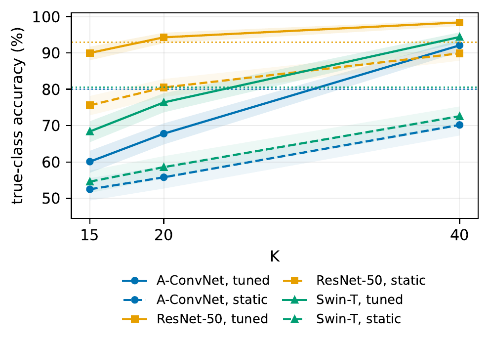
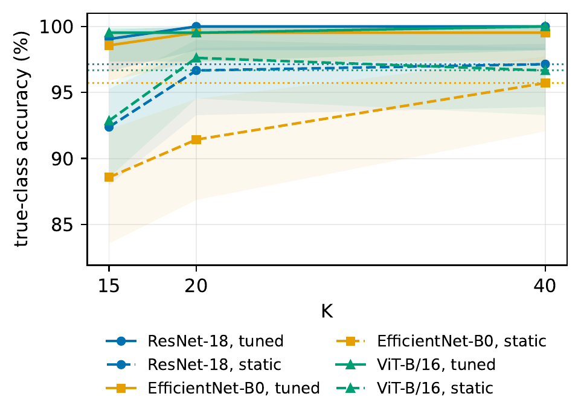
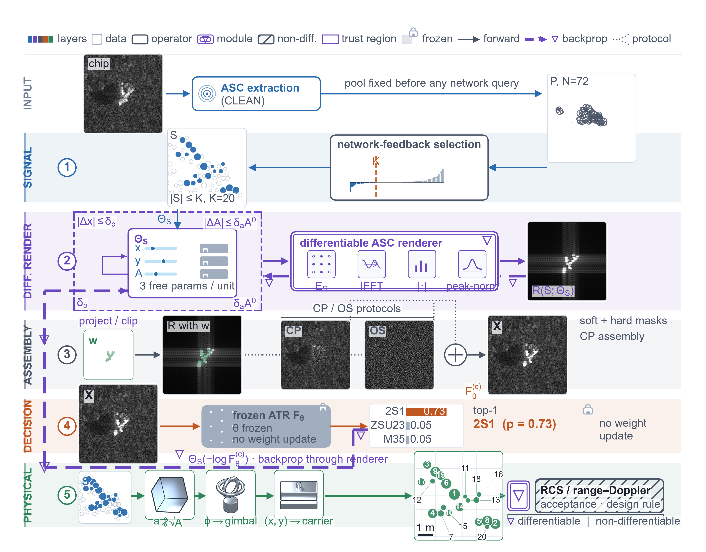
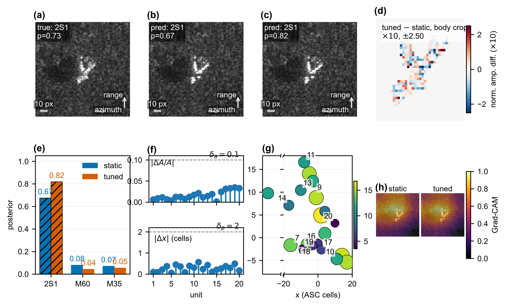
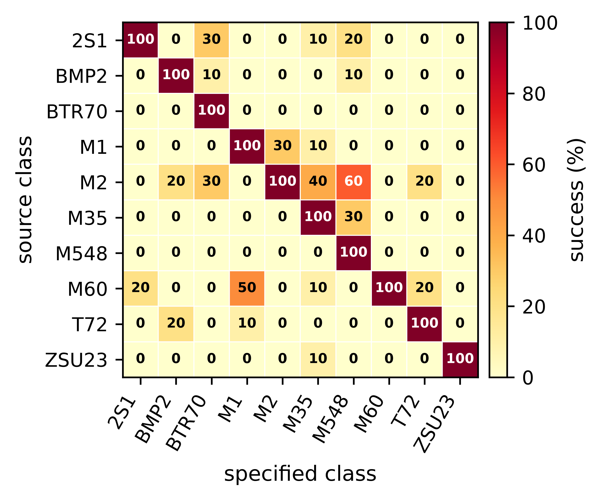
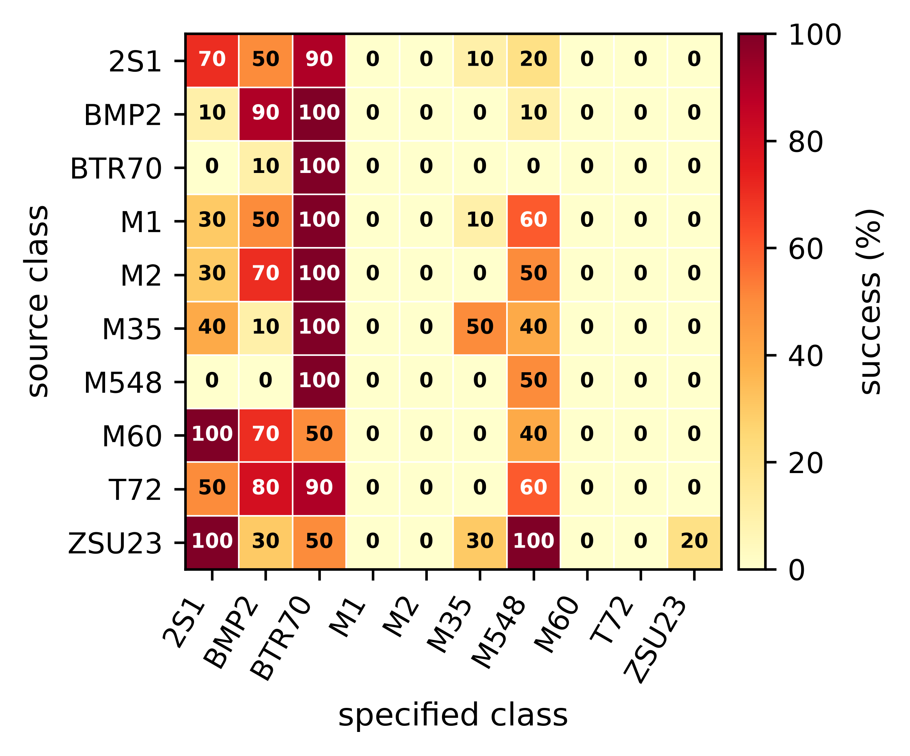
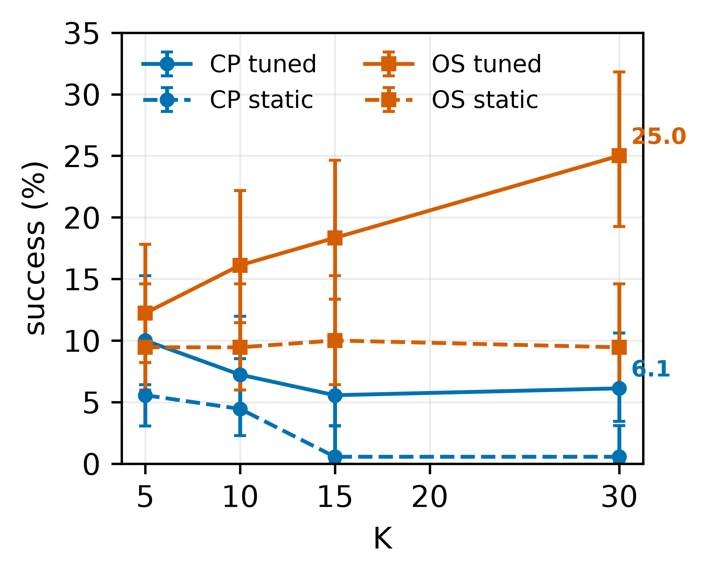
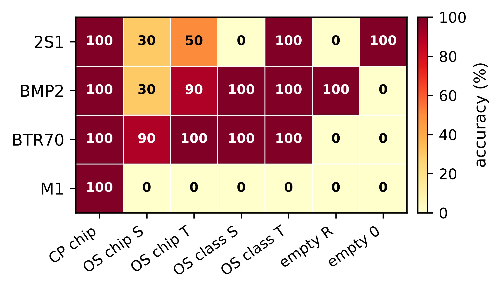

# Constructive Feature Samples — Selected Results

This repository hosts selected result figures and summary numbers for a study
on **constructive feature samples**: sparse fields of reconfigurable
trihedral corner reflectors are selected and tuned so that a frozen SAR
automatic target recognition (ATR) network reads an intended class.

The repository contains **result figures and summary numbers only**. It does
not contain datasets, model weights, source code, or per-chip records.

## Method in one paragraph

A candidate pool of attributed scattering centres (ASCs) is extracted from a
measured SAR chip. A network-feedback marginal-benefit rule selects a small
set of centres; a differentiable ASC renderer then tunes their positions and
amplitudes inside a physical trust region. The tuned field is assembled with
the background or an empty scene and scored by the frozen ATR. Two protocols
are used: context-preserving (CP), which keeps the measured background and
shadow and therefore gives an oracle upper bound when the target class is the
true class; and open-scene (OS), which places the field in an empty scene and
is used only to delimit the simulation-based boundary.

## Selected results

### Budget curves under CP

| Dataset / network | tuned-15 | tuned-full | full-untuned |
|---|---:|---:|---:|
| MSTAR SOC / A-ConvNet | 60.1 | 95.5 | 80.0 |
| MSTAR SOC / ResNet-50 | 90.0 | 98.7 | 92.9 |
| MSTAR SOC / Swin-T | 68.4 | 97.1 | 80.6 |
| SAMPLE / ResNet-18 | 99.05 | 100.00 | 97.14 |
| SAMPLE / EfficientNet-B0 | 98.57 | 99.52 | 95.71 |
| SAMPLE / ViT-B/16 | 99.52 | 100.00 | 96.67 |

All entries are top-1 accuracy (%). CP uses the true class as the specified
class, so the numbers are oracle-scored sufficiency results, not physical
classification rates.

### Method framework and sample card

### Class specificity

The CP cross-class matrix has a 100% diagonal and a pooled off-diagonal rate
of 5.1%; the OS matrix has a 38.0% diagonal and a 21.6% off-diagonal rate. The
random-wrong-target control is 4.0% for CP and 29.0% for OS. The construction
is therefore class-specific rather than a universal constructor.

### OS boundary

The open-scene result is class- and template-dependent. An empty scene removes
the measured context the frozen network uses; the footprint ablation shows
that the mask contour alone does not carry the class. The OS protocol is a
boundary, not a physical rate.

## Files

- `figures/method_framework.*` — signal, physical, and decision layers.
- `figures/mstar_k_curves.*`, `figures/sample_k_curves.*` — budget curves.
- `figures/sample_card.*` — one 2S1 card (static/tuned fields, difference,
  posteriors, trust-region movement, deployment layout, Grad-CAM).
- `figures/cross_class_cp.*`, `figures/cross_class_os.*`,
  `figures/cross_class_k.*` — class-specificity diagnostics.
- `figures/os_boundary.*` — OS class-by-condition boundary.

## Scope

The figures are provided for result inspection and research reference. No data,
model weights, or code are distributed here.
